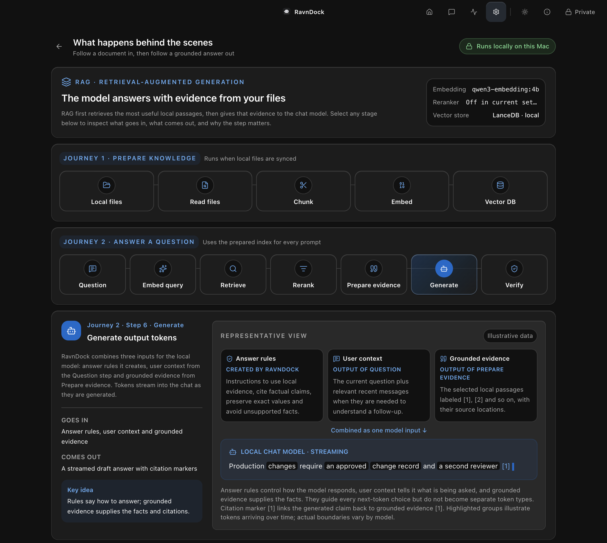

# RavnDock

RavnDock is a private AI chat app for your own files. Choose a folder on your Mac,
let RavnDock build a local knowledge base, then ask questions in plain language.
Your documents, prompts, search index, and chat history stay on your Mac.

## Start here

1. Download `RavnDock-1.1.0-arm64.dmg` from
   [GitHub Releases](https://github.com/mfakbar/pocket-RAG/releases).
2. Drag RavnDock into **Applications**.
3. Open the app, choose a folder, select a model profile, and synchronize your files.
4. Ask a question and open its citations to verify the source.

RavnDock currently supports Apple Silicon Macs with at least 16 GB unified memory.
The app is independently distributed and not Apple-signed, so the first launch may
require **System Settings → Privacy & Security → Open Anyway**.

## Why use it

- **Private by default.** Document processing, search, and chat run locally.
- **Simple setup.** Pick a folder and a model profile; RavnDock manages the local tools.
- **Traceable answers.** Citations can point to PDF pages, slides, spreadsheet cells,
  document headings, CSV rows, or text lines.
- **Built for everyday Macs.** Model recommendations account for available memory,
  and resource monitoring makes local AI activity visible.

## RAG behind the scenes

RAG (retrieval-augmented generation) finds useful passages in your files before the
local chat model writes an answer. The walkthrough below follows a document from
indexing through retrieval, output-token generation, and citation checks.

<a href="https://mfakbar.github.io/pocket-RAG/rag-behind-the-scenes.html" target="_blank" rel="noopener noreferrer"><strong>Open the interactive RAG behind-the-scenes walkthrough ↗</strong></a>

<a href="https://mfakbar.github.io/pocket-RAG/rag-behind-the-scenes.html" target="_blank" rel="noopener noreferrer"></a>

The preview uses illustrative content; it does not expose customer documents or live
application data.

## Details

### How it works

1. RavnDock reads supported files while preserving source locations.
2. It splits long content into searchable passages and creates local embeddings.
3. LanceDB stores the passages, vectors, keywords, and citation metadata locally.
4. For each question, hybrid search finds relevant evidence; an optional local
   reranker can improve ambiguous results.
5. The local chat model receives answer rules, the question context, and grounded
   evidence, then streams a draft one token at a time.
6. RavnDock checks citation markers and factual support before presenting the answer.

The app uses Electron and React for the desktop experience, Ollama for local chat and
embedding models, a RavnDock-owned Python sidecar for extraction and retrieval,
Docling plus format-specific readers for documents, and LanceDB for the local search
index. Users do not need to manage these components.

For implementation details—including data flow, local storage, retrieval modes,
model residency, and verification—read
[`docs/ARCHITECTURE.md`](docs/ARCHITECTURE.md).

### Local AI tradeoffs

Local processing keeps sensitive content on the device, but model downloads can be
large, first responses can take longer, and larger models use more memory. Performance
depends on the Mac's available memory and thermal state. RavnDock warns when a model
may be too large and lets users choose between Performance, Balanced, and High Quality
profiles.

Accuracy still depends on document quality, question clarity, retrieval quality, and
the selected model. Citations are provided so important answers can be checked against
the original files.

### Development

Requirements: Apple Silicon macOS, Node.js, npm, `uv`, and Ollama.

```bash
npm install
uv sync --project rag-backend --python 3.14
npm run dev
```

Verification:

```bash
npm run typecheck
npm test
npm run test:backend
npm run rag:regression-check
npm run build
```

### Releases and privacy

The release workflow builds and verifies an unsigned Apple Silicon DMG, then can
attach it to a GitHub Release. See
[`docs/GITHUB_RELEASE.md`](docs/GITHUB_RELEASE.md).

Read the repository privacy policy at
[`docs/PRIVACY_POLICY.md`](docs/PRIVACY_POLICY.md).

### Support

RavnDock is designed by Muhammad F. Akbar, a data center and AI infrastructure
consultant based in Indonesia. Feedback is welcome at
[mfa.akbar@gmail.com](mailto:mfa.akbar@gmail.com) or
[muakbar@cisco.com](mailto:muakbar@cisco.com).

Additional architecture and release notes are available in [`docs`](docs/).
